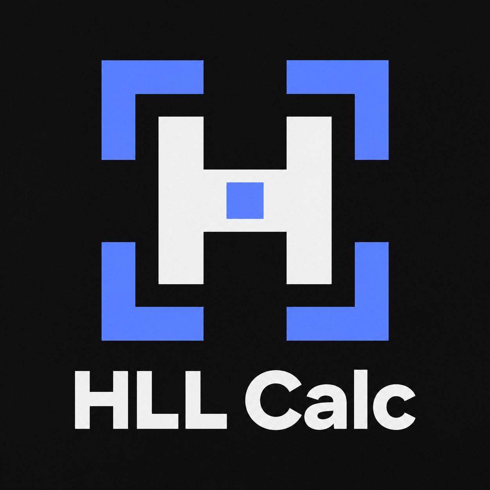

## HLL Calc（人间地狱计算器）

使用 C++ 开发的人间地狱辅助工具。

## 使用方法

从仓库的 **Releases** 下载 `HLLCalc-版本-windows-x64.zip`，解压后运行 `HLLCalc.exe`。	

支持 Windows 10/11 x64。

- **默认快捷键 `\`**：呼出/收起计算器；左侧“快捷键设置”支持录制或手动选择单键及组合键，自动保存。
- 支持德、美、苏、英四国自行火炮/常规火炮计算，提供目标距离前后 15 米、每行 3 米的参考表。
- 准星独立置顶、鼠标穿透；计算器收起后继续显示，支持形状、颜色、尺寸、透明度、显示器与标尺设置。
- 支持 CS / CS2 分享码导入，**仅保留基础静态外观，不模拟移动、开火、扩散或后坐力**。
- 关闭/最小化窗口只收起；通过“退出程序”或托盘菜单才会彻底退出。
- 侧栏底部显示当前版本，点击可进入“设置与更新”；支持简体中文 / English 即时切换，语言偏好自动保存。

详细操作见 [使用说明](docs/USAGE.zh-CN.md)。

## 开发与构建

安装 Visual Studio 2022/2026 的 C++ 桌面开发工具（含 Windows SDK/CMake），在仓库根目录运行：

```bat
build.cmd
```

程序位于 `build/HLLCalc.exe`。源码按 `src/` 功能模块、`tests/`、`resources/`、`cmake/`、`scripts/` 和 `docs/` 整理；第三方源码本地随仓库提供，构建时不需要联网下载。

构建参数和测试方法见 [构建说明](docs/BUILDING.md)。真实键鼠测试需显式启用，默认 CI 不运行桌面输入测试。


## 声明与许可

主项目采用 **GPL-3.0-only**，完整许可见 [LICENSE](LICENSE)。第三方组件保留各自的 MIT 或原始许可声明，详见 [THIRD_PARTY_NOTICES.md](THIRD_PARTY_NOTICES.md)。公开源码或非盈利不替代许可证要求。

功能/经验参数与界面参考来源：

[AimerHLL](https://github.com/AimerSo/AimerHLL) 	

[b-launcher](https://github.com/cubk1/b-launcher)	

### 免责声明

本工具仅依据手工输入进行计算，通过独立桌面窗口显示准星；不读取、不注入、不修改游戏进程或内存。

建议使用游戏的**窗口或无边框窗口模式**；普通置顶窗口不能保证覆盖独占全屏。请自行遵守游戏及服务器规则，本项目不承诺反作弊兼容性。公式为游戏经验参数，不是现实火炮弹道模型；游戏更新后的有效性需重新核对。
